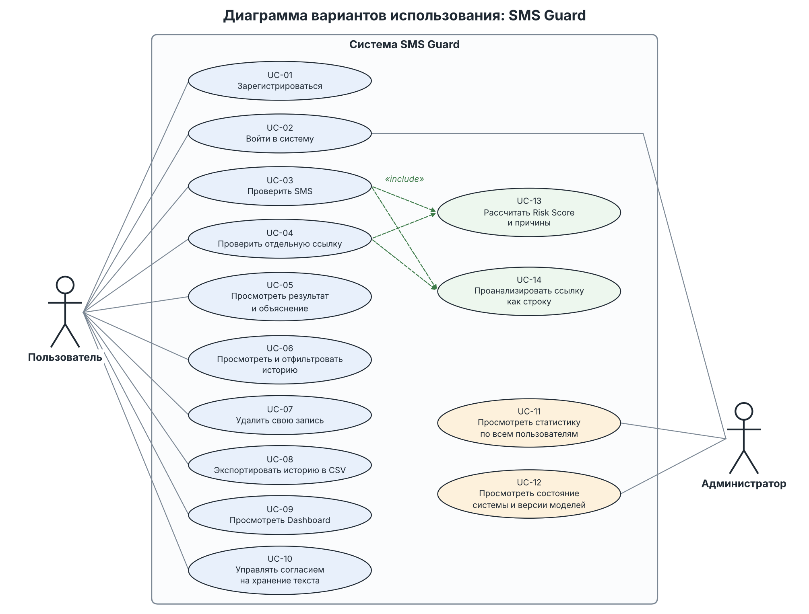

# Задание 1. Анализ предметной области и проектирование системы

**Проект:** SMS Guard — интеллектуальная система обнаружения мошеннических SMS и подозрительных ссылок.
**Дата:** 3 ноября 2026 г.

Все примеры сообщений в этом документе искусственные. Ссылки в них используют только зарезервированные домены (`.example`, `.test`), телефоны и номера карт вымышлены, организации названы обобщённо.

## 1. Описание проблемы

Смишинг — это фишинг через SMS: злоумышленник выдаёт себя за банк, службу доставки, госорган или родственника и добивается перевода денег либо передачи учётных данных. Типовая атака сочетает две части: **текст с психологическим давлением** и **ссылку на поддельный сайт**. Поэтому анализ только текста или только ссылки недостаточен, и в SMS Guard обе части проверяются отдельно, а затем объединяются в один уровень риска.

Для Казахстана проблема практическая. По данным МВД РК, опубликованным Kazinform, Антифрод-центр предотвратил вывод 2,6 млрд тенге, заблокировано около 67 млн звонков с фиктивных зарубежных номеров, а к уголовной ответственности привлечены 870 человек ([Kazinform](https://www.inform.kz/ru/antifrod-tsentr-pomog-sberech-kazahstantsam-26-mlrd-tenge-01c381); период в статье не указан). Эти цифры описывают мошенничество в целом и звонки, а не только SMS, но показывают масштаб. Рядовой пользователь при этом не может быстро оценить структуру URL, а правила фильтрации операторов не покрывают новые шаблоны.

## 2. Категории угроз

Ниже описаны 8 категорий (по заданию не менее 6). Признаки социальной инженерии указаны по шкале из ТЗ: срочность, страх, авторитет, выгода, секретность.

| № | Категория | Искусственный пример SMS | Признаки социальной инженерии | Технические признаки |
|---|---|---|---|---|
| 1 | Поддельный банк | «Банк: вход в ваш кабинет с нового устройства. Если это не вы, подтвердите данные: http://secure-bank-verify.example/login» | Авторитет (банк), страх (чужой вход), срочность | Ссылка не на домен банка, слова `secure`, `verify`, `login` в домене и пути |
| 2 | «Блокировка карты» | «Ваша карта заблокирована! Срочно подтвердите данные в течение 24 часов: http://card-unlock.example» | Страх (потеря доступа к деньгам), срочность («24 часа»), авторитет | Восклицания, ограничение по времени, требование перейти по ссылке |
| 3 | Выигрыш или приз | «Поздравляем! Вы выиграли 500 000 тг. Для получения приза оплатите комиссию 2 000 тг: http://prize-claim.example» | Выгода, срочность («приз сгорит»), иногда секретность | Сумма денег, требование предоплаты, подозрительные слова `prize`, `bonus` |
| 4 | Служба доставки | «Посылка не доставлена: неверный адрес. Оплатите 350 тг до конца дня: http://parcel-redelivery.example/pay» | Авторитет (служба), срочность, небольшая «незаметная» сумма | Малая сумма для кражи данных карты, домен не принадлежит службе, путь `/pay` |
| 5 | «Родственник в беде» | «Мама, это я, телефон разбился, пишу с чужого номера. Срочно переведи 50 000 тг на этот номер, потом объясню» | Срочность, страх за близкого, секретность («никому не говори»), авторитет близкого | Ссылки часто нет, поэтому URL-анализ не сработает и всё решает текстовая модель |
| 6 | Запрос кода из SMS | «Служба безопасности банка: для отмены подозрительного перевода назовите код из SMS оператору» | Авторитет (служба безопасности), страх, срочность | Прямая просьба сообщить код или пароль, ссылки нет |
| 7 | Госуслуги и штрафы | «Неоплаченный штраф 15 000 тг. Оплатите со скидкой 50% до 18:00, иначе дело передадут приставам: http://gov-fine-pay.test» | Авторитет (госорган), страх (приставы), выгода (скидка), срочность | Домен не из зоны госоргана, ограничение времени, сумма |
| 8 | Инвестиционное мошенничество | «Заработок от 300 000 тг в неделю на инвестициях. Гарантированная прибыль, мест мало: http://fast-profit-invest.example» | Выгода, срочность («мест мало»), авторитет (выдуманный эксперт) | Обещание гарантированного дохода, домен с `profit`, `invest` |

Из таблицы следует важный вывод для проектирования: категории 5 и 6 обычно приходят **без ссылки**. Значит, система не может полагаться только на URL-модель, и текстовый анализ обязателен.

## 3. Анализ аналогов

| Аналог | Назначение | Сильные стороны | Ограничения |
|---|---|---|---|
| **Встроенный фильтр смартфона (Google Messages)** | Автоматическая защита входящих сообщений | Работает без действий пользователя. Модели на устройстве ищут шаблоны спама у отправителей вне контактов, а ссылки проверяются на безопасность ([Google](https://support.google.com/messages/answer/9327903?hl=en)) | Новые схемы могут быть не распознаны. Причина решения пользователю обычно не объясняется. Google не публикует точность и долю ложных срабатываний. Качество на казахском не заявлено |
| **Google Safe Browsing** | Проверка URL по спискам небезопасных сайтов | Бесплатный API, большие и постоянно обновляемые списки угроз | Только для некоммерческого использования, для коммерции предлагается Web Risk ([Google](https://developers.google.com/safe-browsing/v4/usage-limits)). Работает со ссылками, а не с текстом. Новый домен может ещё не быть в списках |
| **VirusTotal** | Проверка URL и файлов множеством антивирусных движков | Агрегирует много источников, даёт подробный отчёт | Публичный API: 4 запроса в минуту и 500 в день, запрещён в коммерческих продуктах ([VirusTotal](https://docs.virustotal.com/reference/public-vs-premium-api)). Текст SMS не анализирует. Ориентирован на подготовленного пользователя |
| **Антиспам операторов и Антифрод-центр** | Блокировка спама и мошеннических номеров на уровне сети и банков | Действует до пользователя, закрывает массовые рассылки и поддельные номера | Не покрывает новые шаблоны текста. Решение непрозрачно для пользователя. Отдельное сообщение нельзя проверить самостоятельно |

**Вывод.** Ни один из аналогов не сочетает в одном инструменте анализ текста, анализ структуры ссылки и понятное объяснение на русском языке. Эту нишу и занимает SMS Guard: пользователь сам вставляет сомнительное сообщение, а система показывает, какие признаки сработали. SMS Guard не заменяет перечисленные средства и носит рекомендательный характер.

## 4. Целевая аудитория и роли

**Целевая аудитория:** обычные пользователи мобильной связи в Казахстане без технической подготовки, в первую очередь люди, получившие подозрительное сообщение, включая старшее поколение, студентов и клиентов банков. Вторая группа — администратор проекта, который следит за работой системы.

| Роль | Что может делать | Чего не может |
|---|---|---|
| **Гость** | Открыть страницу входа, зарегистрироваться | Открывать проверку, историю, Dashboard и профиль |
| **Пользователь** | Проверять SMS и URL, смотреть результат и объяснение, работать со своей историей и Dashboard, управлять согласием на хранение текста | Видеть чужие проверки |
| **Администратор** | Всё, что пользователь, плюс агрегированная статистика по системе и сведения о версиях моделей | Читать тексты SMS других пользователей (ФТ-1.9) |

Гость не считается отдельной ролью проекта. Обязательных ролей две, как требует задание: «Пользователь» и «Администратор».

## 5. Диаграмма вариантов использования

Диаграмма содержит 14 прецедентов и обе роли. Прецеденты UC-13 и UC-14 подключаются через «include»: они выполняются внутри проверки, а не вызываются пользователем отдельно. Источник диаграммы: `docs/diagrams/build_use_case.py`.

| Код | Прецедент | Роль | Связанные требования |
|---|---|---|---|
| UC-01 | Зарегистрироваться | Пользователь | ФТ-1.1, ФТ-1.2 |
| UC-02 | Войти в систему | Пользователь, Администратор | ФТ-1.3, ФТ-1.5 |
| UC-03 | Проверить SMS | Пользователь | ФТ-2.1…2.8 |
| UC-04 | Проверить отдельную ссылку | Пользователь | ФТ-3.1…3.11 |
| UC-05 | Просмотреть результат и объяснение | Пользователь | ФТ-5.4, ФТ-5.5 |
| UC-06 | Просмотреть и отфильтровать историю | Пользователь | ФТ-7.1…7.3 |
| UC-07 | Удалить свою запись | Пользователь | ФТ-7.4 |
| UC-08 | Экспортировать историю в CSV | Пользователь | ФТ-7.6 |
| UC-09 | Просмотреть Dashboard | Пользователь | ФТ-6.1…6.7 |
| UC-10 | Управлять согласием на хранение текста | Пользователь | ФТ-7.5 |
| UC-11 | Просмотреть статистику по всем пользователям | Администратор | ФТ-1.9, ФТ-6.8 |
| UC-12 | Просмотреть состояние системы и версии моделей | Администратор | ФТ-4.3, НФТ-14 |
| UC-13 | Рассчитать Risk Score и причины | Включается в UC-03, UC-04 | ФТ-5.1…5.5 |
| UC-14 | Проанализировать ссылку как строку | Включается в UC-03, UC-04 | ФТ-3.2…3.9 |

## 6. Таблица требований

Коды ФТ-1.x…3.x и НФТ-x взяты из ТЗ. Разделы 2.4–2.7 ТЗ написаны списком и кодов не имеют, поэтому коды ФТ-4.x…7.x присвоены здесь, чтобы у каждого требования был код. Приоритет указан по MoSCoW: **M** — Must, **S** — Should, **C** — Could.

Если требование обязательно по ТЗ, стоит M. Приоритет S поставлен там, где система работает и без пункта, но заметно слабее. Приоритет C поставлен только у пунктов, которые ТЗ само называет необязательными или дополнительными.

### Функциональные требования

| Код | Требование | Приоритет |
|---|---|---|
| ФТ-1.1 | Регистрация по логину, e-mail и паролю с проверкой формата | M |
| ФТ-1.2 | Уникальность логина и e-mail, понятная ошибка при повторе | M |
| ФТ-1.3 | Вход по логину и паролю; после 5 неудач подряд пауза не менее 60 с | M |
| ФТ-1.4 | Пароли хранятся только как хеш с солью | M |
| ФТ-1.5 | Выход уничтожает сессию | M |
| ФТ-1.6 | Проверка, история, Dashboard и профиль только после входа | M |
| ФТ-1.7 | Пользователь видит только свои проверки; чужая запись даёт 404 или 403 | M |
| ФТ-1.8 | Cookie: HttpOnly, SameSite=Lax, Secure при HTTPS; CSRF-токен в POST-формах | M |
| ФТ-1.9 | Администратор видит агрегированную статистику без чужих текстов SMS | S |
| ФТ-2.1 | Поле ввода 1–1000 символов; пустой ввод и пробелы отклоняются | M |
| ФТ-2.2 | Определение языка (`ru`, `kk`, `en`, `other`) и вывод в результате | M |
| ФТ-2.3 | Очистка и нормализация текста с заменой сущностей на токены | M |
| ФТ-2.4 | TF-IDF той же векторизацией, что при обучении (единый pipeline) | M |
| ФТ-2.5 | Поиск мошеннических выражений по словарю не менее чем из 6 групп | M |
| ФТ-2.6 | Классификация ML-моделью с вероятностью `P_sms` от 0 до 1 | M |
| ФТ-2.7 | Автоматическая передача URL из текста в модуль ссылок (до 3) | M |
| ФТ-2.8 | Предупреждение о сниженной надёжности для языка вне обучающих данных | M |
| ФТ-3.1 | Проверка формата URL: схема и длина до 2048 символов | M |
| ФТ-3.2 | Извлечение не менее 20 числовых признаков | M |
| ФТ-3.3 | Обнаружение IP-адреса вместо домена | M |
| ФТ-3.4 | Подсчёт поддоменов, точек, дефисов, цифр, спецсимволов | M |
| ФТ-3.5 | Проверка HTTPS, нестандартного порта, символа `@`, двойного `//` | M |
| ФТ-3.6 | Распознавание сокращателей URL (не менее 15 сервисов) | M |
| ФТ-3.7 | Подозрительные ключевые слова в URL | M |
| ФТ-3.8 | Признаки маскировки: Punycode, смешение алфавитов, сходство с брендом | M |
| ФТ-3.9 | Классификация ML-моделью с `P_url` и категорией | M |
| ФТ-3.10 | Ссылки в результатах некликабельны, домен выделен | M |
| ФТ-3.11 | Необязательно: запрос к внешнему сервису репутации с таймаутом 3 с | C |
| ФТ-4.1 | SMS-модель: pipeline TF-IDF и классификатор, сравнение не менее 3 алгоритмов | M |
| ФТ-4.2 | URL-модель: числовые признаки и классификатор, сравнение не менее 2 алгоритмов | M |
| ФТ-4.3 | Модели сохраняются в файлы с метаданными | M |
| ФТ-4.4 | Модели загружаются один раз при старте приложения | M |
| ФТ-4.5 | Результаты двух моделей объединяет модуль оценки риска | M |
| ФТ-5.1 | Risk Score 0–100 и уровень: низкий, средний, высокий | M |
| ФТ-5.2 | Учёт `P_sms`, максимальной `P_url`, групп признаков, совпадения признаков | M |
| ФТ-5.3 | Пороги и веса в `risk_config.yaml`, подбор на валидационной выборке | M |
| ФТ-5.4 | Не менее одной причины и рекомендация для каждого результата | M |
| ФТ-5.5 | Постоянное предупреждение о вероятностном характере оценки | M |
| ФТ-6.1 | Dashboard: общее число проверенных SMS и URL | M |
| ФТ-6.2 | Dashboard: число безопасных, подозрительных и мошеннических | M |
| ФТ-6.3 | Dashboard: распределение по категориям | M |
| ФТ-6.4 | Dashboard: динамика по дням за 30 дней | M |
| ФТ-6.5 | Dashboard: распределение уровней риска | S |
| ФТ-6.6 | Dashboard: топ-5 признаков социальной инженерии | S |
| ФТ-6.7 | Dashboard: таблица из 5–10 последних проверок | M |
| ФТ-6.8 | Dashboard по всей системе для администратора | S |
| ФТ-7.1 | Сохранение даты, типа, категории, риска, вероятностей, объяснения, версий моделей | M |
| ФТ-7.2 | Список с пагинацией по 20 записей, новые сверху | M |
| ФТ-7.3 | Фильтры: даты, тип, категория, уровень риска | M |
| ФТ-7.4 | Просмотр подробного результата и удаление своей записи | M |
| ФТ-7.5 | Текст хранится только с согласия; иначе маскированная версия | M |
| ФТ-7.6 | Экспорт своей истории в CSV | C |

### Нефункциональные требования

| Код | Группа | Требование | Приоритет |
|---|---|---|---|
| НФТ-1 | Производительность | Анализ SMS с URL на сервере не более 500 мс | M |
| НФТ-2 | Производительность | Dashboard при 1000 записях не более 2 с | S |
| НФТ-3 | Производительность | Повторная отправка формы не создаёт дубликат | S |
| НФТ-4 | Безопасность | Запросы к БД только через ORM или параметры | M |
| НФТ-5 | Безопасность | Ввод экранируется при выводе, `<script>` показывается как текст | M |
| НФТ-6 | Безопасность | Не более 30 проверок в минуту, затем ответ 429 | M |
| НФТ-7 | Безопасность | Секреты в `.env`, `DEBUG=False` в демонстрации | M |
| НФТ-8 | Безопасность | Загрузка файлов, если реализована: только `.txt`/`.csv`, до 1 МБ | C |
| НФТ-9 | Приватность | Тексты SMS не пишутся в логи | M |
| НФТ-10 | Удобство | Адаптивная вёрстка: 360, 768 и 1366 px | M |
| НФТ-11 | Удобство | Ошибки ввода на русском рядом с полем | M |
| НФТ-12 | Надёжность | Некорректный ввод не вызывает ошибку 500 | M |
| НФТ-13 | Надёжность | Ошибки в `logs/app.log` с ротацией | M |
| НФТ-14 | Надёжность | Без файла модели приложение стартует и сообщает о недоступности | M |
| НФТ-15 | Сопровождаемость | Покрытие `ml/` и `risk/` тестами не менее 60% строк | S |

## 7. Ограничения проекта

- Набор SMS Spam Collection содержит только английские сообщения. До теста с Recall не ниже 0,80 на собственном наборе поддержка русского и казахского не заявляется: для `ru` и `kk` работают словарь и URL-анализ, а ML-оценка текста помечается как ненадёжная.
- Спам в наборе не равен мошенничеству в строгом смысле: туда входит и обычная реклама.
- Ссылки анализируются только как строки. Система не открывает их и не загружает страницы.
- Оценка носит вероятностный характер и не гарантирует безопасность.

## Источники

- [Google Messages: защита от спама](https://support.google.com/messages/answer/9327903?hl=en)
- [Google Safe Browsing API: ограничения использования](https://developers.google.com/safe-browsing/v4/usage-limits)
- [VirusTotal: публичный и премиум API](https://docs.virustotal.com/reference/public-vs-premium-api)
- [Kazinform: Антифрод-центр помог сберечь казахстанцам 2,6 млрд тенге](https://www.inform.kz/ru/antifrod-tsentr-pomog-sberech-kazahstantsam-26-mlrd-tenge-01c381)
