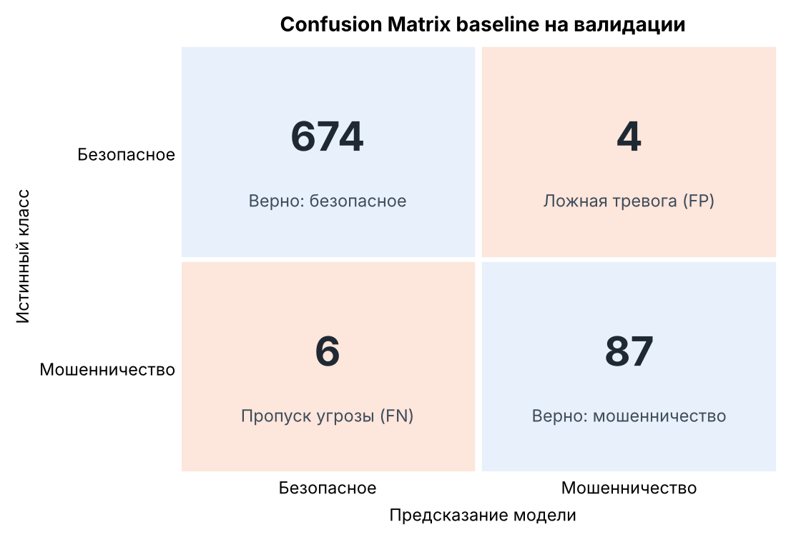

# Задание 7. Отчёт о базовой модели

**Модель:** Logistic Regression (`class_weight='balanced'`, `max_iter=1000`) в одном `Pipeline` с признаками задания 6.
**Файл модели:** `ml/artifacts/sms_baseline.joblib`.
**Код:** `ml/baseline.py`, ноутбук `notebooks/03_baseline_sms.ipynb`.

Все метрики рассчитаны на валидационной выборке из 771 сообщения. Тестовая выборка не использовалась.

## Метрики для класса «мошенничество»

| Метрика | Значение |
|---|---:|
| Accuracy | 0,987 |
| Precision | 0,956 |
| Recall | 0,935 |
| F1 | 0,946 |

| | Предсказано: безопасное | Предсказано: мошенничество |
|---|---:|---:|
| **Истинно безопасное** | 674 | 4 (FP) |
| **Истинно мошенничество** | 6 (FN) | 87 |

Эти значения относятся к валидации и не являются итоговой оценкой: итоговые метрики на тесте будут получены один раз в задании 8.

## Разбор ошибок

На валидации 6 FN и только 4 FP. В разборе показаны 5 FN с самой низкой вероятностью и все 4 FP. Десятой строкой идёт безопасное сообщение, ближе всех подошедшее к порогу: оно не ошибка и добавлено, чтобы разбор содержал 10 примеров.

| Вид | id | Вероятность | Начало сообщения | Комментарий |
|---|---:|---:|---|---|
| FN | 2775 | 0,035 | How come it takes so little time for a child… | Шутка-рассылка без денег, ссылок и телефона. Сигналов нет |
| FN | 1431 | 0,083 | For sale - arsenal dartboard… | Объявление похоже на личное сообщение, токенов и давления нет |
| FN | 1639 | 0,146 | 0A$NETWORKS allow companies to bill for SMS… | Рассуждение без призыва к действию, запись `0a$networks` модели незнакома |
| FN | 2771 | 0,245 | Burger King - Wanna play footy… | Реклама с розыгрышем, нет суммы и телефона. Это реклама, а не мошенничество |
| FN | 1501 | 0,279 | SMS. ac JSco: Energy is high… | Подписка на гороскоп сленгом, нет суммы, телефона и ссылки |
| FP | 3095 | 0,705 | staff.science.nus.edu.sg/~phyhcmk/… | Сообщение состоит только из ссылки, а `<url>` редок в ham |
| FP | 3739 | 0,616 | Plz note: if anyone calling from a mobile Co… | Предупреждение о мошенниках содержит лексику самой схемы |
| FP | 2280 | 0,598 | Hmm...Bad news...Hype park plaza $700… | Две суммы дают два токена `<money>` |
| FP | 3850 | 0,508 | Can you plz tell me the ans… | Подпись сервиса `fullonsms.com` стала токеном `<url>` |
| Близко к порогу | 1201 | 0,493 | NEFT Transaction with reference number… | Банковское уведомление. Ответ верный, но запас мал |

**Пропуски.** Показанные FN не содержат ссылки, суммы и телефона. Это реклама и подписки, что подтверждает ограничение набора: спам не равен мошенничеству.

**Ложные тревоги.** Все 4 FP связаны с признаками, которые редки в ham: `<url>`, `<money>` или длинный текст с призывами.

## Проверка на новых текстах

Модель загружена из файла. Предсказания и вероятности на валидации совпали с исходными. Тексты ниже придуманы для проверки, их нет в наборе.

| Текст | Метка | Вероятность | Оценка |
|---|---:|---:|---|
| Hey, are we still meeting for lunch tomorrow? | 0 | 0,018 | Верно |
| Your order #4821 has been shipped and will arrive tomorrow. | 0 | 0,119 | Верно |
| URGENT! Your bank account has been suspended. Verify now at http://secure-bank-verify.example/login | 1 | 0,966 | Верно |
| Congratulations! You won a 1000 pound prize. Call 09061701461 to claim | 1 | 1,000 | Верно |
| Hi, it's Anna, my new number is +7 000 000 00 00 | 1 | 0,911 | **Ложная тревога** |
| Ваша карта заблокирована! Срочно подтвердите данные: http://card-unlock.example | 1 | 0,983 | Верно, но оценка ненадёжна |
| Привет! Встречаемся завтра в 18:00 у входа в библиотеку. | 0 | 0,410 | Верно, но оценка ненадёжна |

## Известные недостатки

1. **Модель переоценивает телефон.** В ham набора телефонов почти нет (1 сообщение из 4 516), поэтому обычный номер сразу поднимает вероятность. Метрики этого не показывают, так как таких сообщений нет в данных. Это предположение EDA подтвердилось ручной проверкой.
2. **Русский и казахский не поддерживаются.** Модель обучена на английском. Качество на собственном наборе будет измерено в задании 8.
3. **Порог 0,5 не подобран.** Подбор выполняется на валидации в задании 8.

## Что дальше

В задании 8 нужно сравнить алгоритмы и варианты признаков, подобрать порог и проверить модель на русско-казахском наборе. Там же стоит сравнить модель с признаком `<phone>` и без него.
